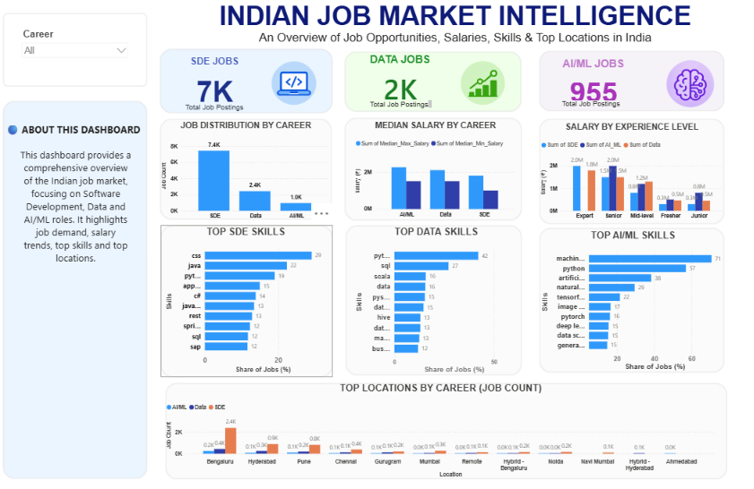
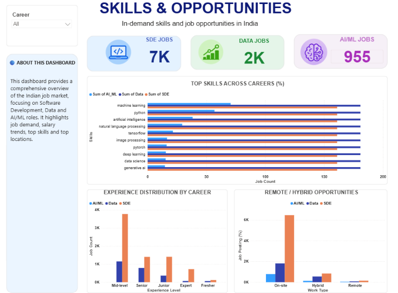

# Indian Job Market Analysis

An exploratory data analytics project focused on understanding the Indian job market across Software Development, Data Science, and AI/ML roles using Python, Pandas, and Power BI.

## Project Overview

This project analyzes job-market data to explore employment trends, salary distributions, experience requirements, in-demand technical skills, and job opportunities across different career domains.

## Tools & Technologies

- **Python:** Data analysis and preprocessing
- **Pandas:** Data cleaning and manipulation
- **Google Colab:** Python development environment
- **Power BI:** Interactive dashboards and data visualization

## Project Workflow

1. Imported and explored the job-market dataset.
2. Cleaned and preprocessed data using Python and Pandas.
3. Analyzed job demand, salaries, experience requirements, and technical skills.
4. Created interactive Power BI dashboards to visualize key findings.

## Dashboard Previews

### 1. Job Market Overview

### 2. Career Comparison

### 3. Skills and Opportunities

## Project Files

- [Python Analysis Notebook](JobTracker.ipynb)
- [Power BI Dashboard](Indian_Job_Market_Intelligence_Dashboard.pbix)

## Key Areas of Analysis

- Job market trends across career domains
- Salary distribution and comparisons
- Experience requirements
- In-demand technical skills
- Job location and employment opportunities

## Skills Demonstrated

Python | Pandas | Data Cleaning | Data Analysis | Power BI | Data Visualization

## Author

Priya

